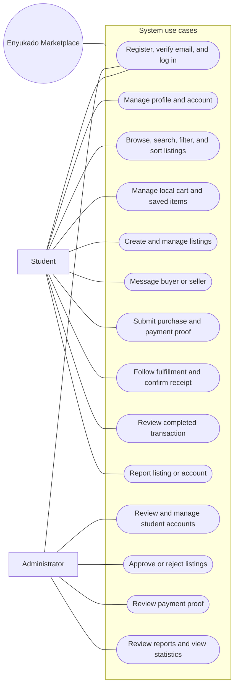
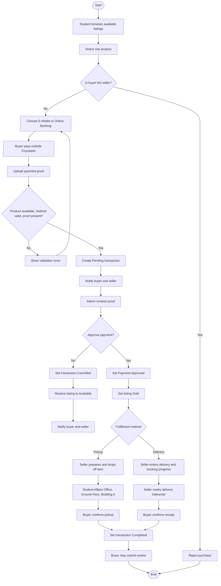
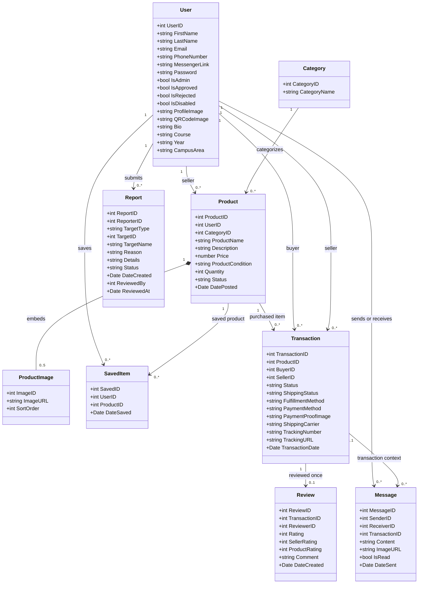
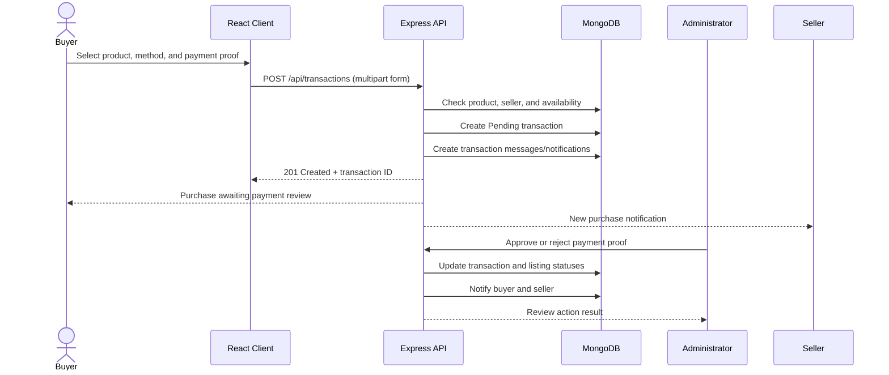
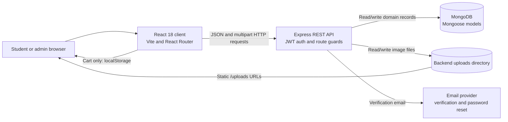

# Enyukado Campus Marketplace
## System Project Documentation

**Institution:** National University Manila  
**System:** Enyukado  
**Document purpose:** Project overview, requirements, transaction rules, system models, and architecture

> **Implementation note:** This document combines the project brief supplied by the team with the behavior visible in the current React and Express/MongoDB source. It describes implemented behavior where it can be confirmed from the source and identifies features that are limited or not evidenced, rather than treating every proposed requirement as already complete.

---

## 1. Project Overview

Enyukado is a campus marketplace intended for National University Manila students. It provides a centralized place to post and discover academic and personal items, contact buyers or sellers, submit purchase requests, and review completed transactions. An administrator moderates student accounts and listings, checks submitted payment proof, and reviews user reports.

The application has a React web client and an Express REST API backed by MongoDB. The API stores student, listing, saved-item, transaction, review, message, and report records. Uploaded product, profile, QR-code, message, and payment-proof images are stored by the backend and exposed through its `/uploads` path.

The marketplace is designed for peer-to-peer transactions. The application records payment method and proof, but does not itself process or settle payments through a payment gateway.

## 2. Problem Statement

Students may use social media, group chats, personal communication, and community groups such as Barkgagi to buy, sell, and exchange items. These channels can make listings, transaction progress, communication, and user reliability difficult to organize and monitor.

Enyukado addresses this need with a centralized marketplace for student accounts, item discovery, listings, buyer-seller messaging, purchase records, reviews, and administrative moderation. Its workflows are intended to make campus transactions easier to follow and provide administrators with tools to review accounts, listings, payment evidence, and reports.

## 3. Project Objectives

### 3.1 General Objective

To develop a secure, centralized, and user-friendly campus marketplace that enables National University Manila students to buy, sell, and exchange academic and personal items, while supporting the management of users, listings, and transactions.

### 3.2 Specific Objectives

1. Provide a student-facing platform for campus buying and selling.
2. Support create, read, update, and delete operations for marketplace data, subject to ownership and moderation rules.
3. Apply software engineering practices in developing, testing, and evaluating the marketplace.
4. Evaluate functionality, usability, security, performance, reliability, and user satisfaction with students and administrators.

The fourth objective describes an evaluation goal. This document does not claim that a formal evaluation or performance test has already been completed.

## 4. Scope and Limitations

### 4.1 Scope

The current application source includes:

- Student registration with university-email verification, login, and password recovery.
- Administrator login and account approval or moderation.
- Student profile management, profile-photo upload, and seller QR-code upload.
- Product listing creation, editing, image upload, browsing, search, filtering, sorting, and moderation.
- A saved-items list and a browser-local shopping cart.
- A single-product purchase submission with payment method and proof image.
- Administrative payment-proof review.
- Pickup and delivery progress updates, buyer confirmation, and transaction history.
- Buyer-seller text and image messaging, including automatic transaction notifications.
- Reviews for completed purchases.
- Reports against listings or student accounts and an admin review workflow.

### 4.2 Limitations and Boundaries

- The student registration and login routes accept addresses ending in `@students.national-u.edu.ph`. Email verification and administrator approval are required, but the code does not independently validate student status against an NU student-information system.
- The cart is saved in the browser's `localStorage`, per user. There is no cart API or persisted server-side cart. Each cart item is checked out separately; checkout does not submit a multi-item order.
- Payment methods shown by the client are **E-Wallet** and **Online Banking**. The buyer uploads an image of payment evidence and an administrator manually approves or rejects it. No bank, card, or e-wallet payment gateway integration is evidenced. The client-side bank/card presentation should not be interpreted as payment processing.
- The backend has a quantity field for listings, but the implemented checkout creates a transaction for one product and does not show quantity decrement or multi-quantity stock reservation.
- Transactions are retained for reference. A listing with purchase records cannot be deleted using the owner/admin delete routes.
- The documented pickup location is configured in the backend as **Student Affairs Office, Ground Floor, Building A**. Delivery tracking relies on seller-entered carrier/tracking information rather than an integrated carrier service.
- Images are saved on the backend host's filesystem. A production deployment needs persistent storage and suitable access controls, backups, and URL configuration for these files.
- Messaging uses API requests and periodic unread-count refresh; no real-time WebSocket transport is evidenced.
- Formal load, security, usability, reliability, and satisfaction results are not included here. They should be measured and reported separately.

## 5. Requirements

### 5.1 Target Users and Stakeholders

| User / stakeholder | Role |
|---|---|
| NU Manila students | Register and sign in; manage profiles; browse and save listings; list items; communicate with other students; submit purchases; follow transaction progress; and review completed purchases. |
| Administrators | Approve/reject or manage student accounts and listings; review payment proof; process reports; and view marketplace/report statistics. |
| NU Manila community | Intended beneficiary of a centralized student-to-student marketplace. |

### 5.2 Functional Requirements and Current Coverage

| Requirement | Current behavior evidenced in the application |
|---|---|
| User registration and login | University-domain email verification is required before registration; student accounts then await administrator approval. Passwords are bcrypt-hashed. Student and admin login are separate. |
| User profile management | Users can view/update profile details, upload a profile photo and QR code, and change or reset a password. Profile fields include phone number, Messenger link, bio, course, year, and campus area. |
| Product listing management | A seller can create, view, edit, and delete their own listings. New listings begin pending approval. Editing an existing listing sends it back for approval. |
| Product browsing, search, filtering, and sorting | Public browsing returns available listings from active student accounts. Supported filters include keyword, category, condition, and minimum/maximum price. Sorting supports newest, oldest, price ascending, and price descending. |
| Shopping cart management | The browser-local cart supports adding/removing items and opening an individual item's checkout. Cart contents are not stored by the API. |
| Transaction management | A buyer submits a single product, payment method, and payment-proof image. An admin reviews proof. The buyer and seller can view their purchase/sales records and authorized transaction details. |
| Saved items | Signed-in users can list, save, check, and remove saved products. |
| Reviews and ratings | A buyer can review a completed transaction once. A seller rating is required for the initial review; a product rating can be submitted with it or added later. Ratings use whole-number values from 1 to 5. |
| Product image upload | Creating a listing requires 3–5 images in the client flow. The API accepts up to five product images and applies image type and size restrictions. Editing can retain images or replace them. |
| Messaging | Signed-in users can send text or image messages, open conversations, search for users, and view unread counts. Purchase events also generate transaction-linked notifications. |
| Admin management | Admin routes support account review, listing review, payment approval/rejection, report review, listing/account actions, counts, and sales/report summaries. |
| Reporting | Signed-in users can report another account or an available/sold listing with a reason and details. Admins can mark reports resolved or dismissed. |

### 5.3 Non-Functional Requirements

| Quality attribute | Project requirement | Implementation notes / evaluation needed |
|---|---|---|
| Security | Protect user information and transactions from unauthorized access. | Password hashing, signed JWTs, authenticated routes, buyer/seller ownership checks, and admin-only route guards are present. Deployment configuration, secure secret management, HTTPS, upload access policy, and security testing remain necessary. |
| Usability | Provide a simple, easy-to-navigate interface. | The React client provides browse, profile, messaging, cart, sell, and admin screens. Usability should be measured with representative students and administrators. |
| Reliability | Respond consistently and preserve accurate marketplace data. | MongoDB persistence and guarded transaction state changes are present. Availability, backup/recovery, race behavior, and failure recovery need operational testing. |
| Performance | Respond efficiently and maintain accurate, consistent data. | The project brief uses “performance” for both efficiency and data accuracy. Define measurable response-time, concurrency, and data-integrity targets before testing. |

### 5.4 Business Rules

1. A listing requires a name, price, description, condition, category, quantity, and images in the current create-listing flow. At least three and at most five images are required on creation.
2. A newly created listing is not public until approved by an administrator.
3. Editing a listing returns it to **Pending Approval**.
4. Only an authenticated user can access protected student functions. Account registration requires the configured university email suffix and verification; student login additionally requires admin approval.
5. A student cannot purchase their own listing.
6. A purchase requires a supported payment method and payment-proof image. The transaction is pending until an admin reviews it.
7. Only the transaction's seller may update fulfillment progress; only its buyer may confirm completion and leave a review.
8. A review is allowed only after the transaction is completed and only once per transaction, except that a missing product rating may be added to an existing review.
9. A seller cannot delete a listing that has purchase records.
10. Users cannot report their own account or listing. Reports are limited to the reportable target types and reasons implemented by the API.

### 5.5 Requirements Gathering

According to the project brief, a structured questionnaire was distributed to 100 NU Manila students to gather information about online buying and selling, fraudulent-transaction experiences, and the perceived need for a campus marketplace. The brief identifies product posting, messaging, image uploads, search/filtering, student verification, and secure login as requirements informed by those responses.

This is project-provided research context; the questionnaire, raw responses, and analysis were not part of the source reviewed for this document.

## 6. System Modeling and Design

### 6.1 Use Case Diagram

**Figure 1. Enyukado use-case view**



**Description:** Students use the marketplace to find and save listings, communicate, list products, and manage their own purchase/sales activity. Administrators handle account and listing moderation, payment evidence, and reports. Payment proof is evidence for manual review rather than a gateway charge.

### 6.2 Activity Diagram: Purchase and Fulfillment

**Figure 2. Purchase and fulfillment activity**



**Description:** Each checkout submission creates a transaction for one product. A pending payment is reviewed by an administrator. Rejection cancels that transaction and restores the product to **Available**. Approval marks the product **Sold** and allows the seller to update pickup or delivery progress. The buyer confirms collection/receipt to complete the transaction; completed transactions can be reviewed.

### 6.3 Class Diagram

**Figure 3. Core domain class diagram**



**Description:** MongoDB records use numeric application IDs. Product images are embedded within product documents; the cart is not a backend class/collection and remains in browser storage. A transaction has distinct buyer and seller references. A review is unique per transaction.

### 6.4 Other UML Diagrams

**Figure 4. Purchase-submission sequence**



## 7. System Architecture

**Figure 5. High-level architecture**



### 7.1 Components and Responsibilities

| Component | Responsibility |
|---|---|
| React client | Renders student and admin screens, validates form input, stores the client session, manages the local cart, and calls API wrappers. |
| Express API | Exposes `/api/users`, `/api/products`, `/api/categories`, `/api/transactions`, `/api/reviews`, `/api/saved`, `/api/messages`, `/api/reports`, and `/api/admin` route groups. |
| Authentication middleware | Verifies a bearer JWT, looks up the account, rejects disabled accounts, and attaches the authenticated user identity to the request. Admin routes also require the admin role. |
| MongoDB / Mongoose | Persists users, categories, products, saved items, transactions, reviews, messages, and reports. Counter documents provide numeric IDs used by the API. |
| Upload storage | Stores image files on the backend host. The API serves them under `/uploads`. |
| Email delivery | Sends signup-verification and password-reset codes through the configured provider. |

### 7.2 Important Data and State Flows

#### Account lifecycle

1. Student requests an email verification code for an address ending in `@students.national-u.edu.ph`.
2. Student verifies the code and submits registration details.
3. The API hashes the password and creates an unapproved student account.
4. An administrator approves or rejects the account. Approved students can sign in; disabled accounts are denied access.

#### Listing lifecycle

```text
Create listing -> Pending Approval -> Available -> Sold
                         |               |
                         |               +-> Hidden (admin resolves listing report)
                         +-> Removed (admin rejects pending listing)

Available payment rejected -> Available
```

An owner edit returns the listing to **Pending Approval**. Public browse results are restricted to **Available** items and active sellers. Admin moderation also has access to pending listings and approved/sold listings.

#### Transaction lifecycle

| Transaction status | Meaning / permitted next action |
|---|---|
| `Pending` | Buyer submitted payment method and proof; waiting for admin payment review. |
| `Payment Approved` | Admin approved proof. The listing is marked `Sold`; seller may begin fulfillment updates. |
| `Dropped Off` | Pickup item is ready, or delivery has been marked delivered; buyer may confirm receipt when the corresponding shipping status is ready. |
| `Completed` | Buyer confirmed pickup/receipt; buyer may review the transaction. |
| `Cancelled` | Admin rejected the submitted payment; the listing is restored to `Available`. |

Fulfillment is tracked separately from transaction status:

- **Pickup:** progress includes `Not Started`, `Preparing`, `For Drop Off`, `Dropped Off`, and `Ready for Pickup`. The configured pickup place is the Student Affairs Office, Ground Floor, Building A. Buyer confirmation changes the transaction and shipping status to completed.
- **Delivery:** progress includes `Not Started`, `Preparing`, `Shipped`, `In Transit`, `Out for Delivery`, and `Delivered`. For delivery updates, the seller must supply a carrier and tracking number for shipped/in-transit/out-for-delivery/delivered states. Buyer confirmation is allowed only after the delivery is marked delivered.
- The seller cannot move the shipping status backwards. The selected fulfillment method cannot be changed after shipping has progressed beyond its early states.

The API changes a product to **Sold** when payment is approved, not when the buyer first submits a pending purchase. The current model therefore records purchase requests before the listing's sold transition.

#### Messages and notifications

Student-to-student messages may contain text, an image, or both. They may optionally reference a transaction. The system also records automated messages for purchase submission, payment decisions, pickup/drop-off, shipping updates, and completion. Transaction-specific system notifications are represented separately from ordinary user-to-user conversations. The client refreshes unread counts periodically.

### 7.3 API Route Groups

| Route group | Main operations |
|---|---|
| `/api/users` | Signup verification, student/admin login, profile read/update, profile and QR image upload, password change/reset, and public user lookup. |
| `/api/products` | Browse/search/filter/sort, get a product, list the current user's listings, create/update/delete a listing. |
| `/api/categories` | List categories or retrieve a category. |
| `/api/transactions` | Submit a purchase; retrieve purchases/sales and authorized transaction details; seller drop-off/shipping updates; buyer completion confirmation. |
| `/api/reviews` | Create and retrieve seller/product/transaction reviews. |
| `/api/saved` | List/save/remove/check saved products. |
| `/api/messages` | Send messages, list conversations, retrieve threads/unread count, search users, and retrieve transaction system messages. |
| `/api/reports` | Submit reports against accounts or listings. |
| `/api/admin` | Review/manage accounts and listings, review payment proofs, handle reports, and retrieve counts/statistics. |

### 7.4 Security and Operational Considerations

- Protected API calls use bearer JWTs; tokens issued by the current login routes expire after one day.
- Passwords are hashed using bcrypt. Password reset/signup verification codes are held by the running backend process; operational behavior across restarts and multiple API instances should be considered during deployment.
- `JWT_SECRET`, database connection details, and email-provider credentials must be supplied through private environment configuration. Do not commit real credentials.
- Image upload endpoints enforce file extensions and a 10 MB per-file limit in the relevant routes. Product creation is limited to five images, with at least three required by the create route.
- Production deployment should use HTTPS, a strong configured JWT secret, restricted database/network access, persistent upload storage, backups, and appropriate rate limiting and monitoring.
- A complete security, privacy, and deployment review is outside the scope of this source-derived project description.

## 8. Evaluation Plan

The project objective calls for evaluation of functionality, usability, security, performance, reliability, and satisfaction. A suitable evaluation should include:

1. **Functional tests:** exercise registration/verification, account approval, listing moderation, product search/filter, saved items, purchase proof review, pickup/delivery, reviews, messaging, and reports.
2. **Role and access tests:** verify that unapproved/disabled students cannot use protected routes, that sellers cannot act as buyers and vice versa, and that non-admin accounts cannot call admin routes.
3. **Usability study:** ask representative NU Manila students and administrators to complete common tasks and collect task completion, error, and satisfaction measures.
4. **Performance tests:** define target concurrent users and response-time thresholds, then measure browse, search, messaging, and admin workflows under representative load.
5. **Reliability tests:** check database/file-storage recovery, email delivery failures, duplicate submissions, and the consistency of product/transaction states.
6. **Security tests:** review authentication, authorization, input validation, upload handling, secret configuration, and personal-data exposure.

Report the sample, methods, measurable results, and limitations of each evaluation instead of presenting intended qualities as verified outcomes.

## 9. Implementation and Documentation Basis

This document was prepared from the supplied project description and a source review of the React client, Express routes, Mongoose models, and configuration in the project repository. It is documentation only; it does not make or claim code changes. The document does not certify that the application has been deployed, that every workflow has passed end-to-end testing, or that formal evaluation results are available.
